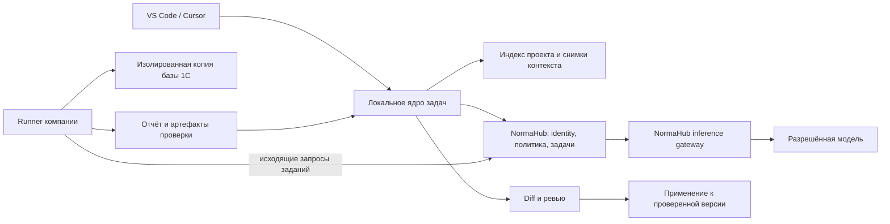

# 1C Copilot: технический и продуктовый план развития AI / B2B

Версия плана: 1.2. Дата актуализации плана и Codex-окружения: 2026-10-29. Runtime evidence ниже относится к проверкам 2026-10-28, если отдельно не указано иное.

План описывает предлагаемый продукт и работы до его выпуска. Он не обозначает будущие возможности как уже реализованные. Пороговые показатели — предлагаемые критерии приёмки, которые нужно согласовать до пилота. Оценки сроков зависят от состава команды, возможностей NormaHub и доступности лицензированных стендов 1С.

## 1. Продуктовое решение

**Цель: помогать команде 1С получать проверенные изменения в своей конфигурации с управляемыми доступами, стоимостью и передачей данных.**

Единица результата: изменение, понятное разработчику и ревьюеру, привязанное к версии проекта и сопровождаемое свидетельствами выполненных проверок. Полезность измеряется временем до принятого результата и последующими исправлениями.

Основной интерфейс остаётся расширением VS Code/Cursor. Основные операции доступны рядом с кодом: выделение, Code Action, inline, diff, проверка и применение. Для аудитории Конфигуратора предусматривается отдельный Windows adapter того же ядра, с собственным решением о выпуске и бюджетом. Организационные политики и расходы управляются в кабинете NormaHub. Исполнение 1С происходит на отдельном тестовом runner компании.

### 1.1. Первая целевая аудитория — рабочая гипотеза

Первый B2B-сегмент: команды 1С из 5–30 разработчиков — внутренние отделы и интеграторы, использующие Git, XML/EDT-выгрузку и отдельную тестовую базу. Компания допускает передачу утверждённых фрагментов кода в разрешённый AI-шлюз. Это рабочая гипотеза для планирования, а не подтверждённый спрос. В P0 проверить её отдельно от сегмента разработчиков, работающих преимущественно в Конфигураторе без Git.

У интегратора одна организация может иметь несколько изолированных проектов разных заказчиков. Права, контекст, runner, артефакты и расход нельзя смешивать между такими проектами даже в рамках одной организации.

Владелец бюджета — руководитель разработки/ИТ. Ежедневный пользователь — разработчик. Ревьюер отвечает за принятие изменения. Администратор определяет доступ к проекту и разрешённые потоки данных.

### 1.2. Первый коммерческий объём

Выпуск **R1 / Design Partner Pilot**:

- Практичное native-автодополнение при прохождении собственного latency/quality gate. Если маршрут его не проходит, R1 выпускается с ручным вызовом и явно ограниченным beta-inline; это не блокирует проверенные query/review.
- AI-запрос по задаче с реальными метаданными, параметрами и проверкой на подготовленных данных.
- AI-review выбранного кода с указанием источников и отдельным предложением небольшого diff.
- Базовый контекст проекта, ограниченный набор инструментов и исполнитель проверок в отдельной базе.
- Организация, проектные права, серверные ограничения моделей/расхода/передачи данных, журнал действий.

Выпуск **R2 / Team GA** расширяет только подтверждённый пилотом объём: управляемые изменения нескольких файлов, ограниченные рефакторинги, проверенные семейства `.cfe`, CI-интеграция и самостоятельный MCP-пакет. Vanessa и AI-анализ ТЖ становятся продаваемыми возможностями после собственных приёмочных проверок, а не автоматически вместе с Team GA.

Выпуск **R3 / Enterprise**: корпоративные способы identity/provisioning, выделенная инфраструктура, дополнительные требования к ключам/хранению, private inference и расширенная эксплуатация. Полностью закрытый контур — отдельная поставка с отдельными затратами и поддерживаемой моделью.

### 1.3. Границы первой версии

Не включать в R1: автономную запись в рабочую базу, автоматическое проведение бизнес-документов в production, обещание поддержки всех ERP/УТ/ЗУП, универсальный конструктор конфигураций, произвольный shell для модели, разработку собственной LLM, обязательную векторную инфраструктуру, автоматическую миграцию любых legacy-проектов и новый полный биллинговый продукт.

Для разработчика, работающего только в Конфигураторе без Git, требуется путь подключения из §4.3. Его discovery и Windows PoC обязательны на раннем этапе; полноценная поставка **R2-C / Configurator** принимается отдельно. Текущий Sidecar/буфер обмена не является достаточной основой корпоративной поставки этого сценария. Отсутствие тестовой базы ограничивает подтверждение результата, независимо от способа подключения редактора.

### 1.4. Конкурентная исходная точка и проверяемое отличие

По документации Mini AI 1C уже предлагает интеграцию с Windows Конфигуратором, diff/apply, BSL LS и несколько провайдеров. Поэтому эти возможности — ориентир совместимости и удобства, а не доказательство нашего превосходства. [README Mini AI 1C](https://github.com/hawkxtreme/mini-ai-1c).

Его MCP-поиск заявляет метаданные, ссылки, impact analysis и граф вызовов. Нельзя позиционировать знание нескольких модулей или метаданных как отсутствующее у конкурента. [Документация MCP-поиска](https://github.com/hawkxtreme/mini-ai-1c/blob/main/tauri-app/mcp-1c-search/README.md).

Это документальная проверка на дату плана, без запуска конкурента на Windows. Производительность, устойчивость и корпоративные свойства конкурента здесь не аттестованы. Для сравнительного запуска фиксируются конкретные версии и артефакты обеих систем; отсутствие у нас доказательств не означает отсутствия у него функции.

Гипотеза нашего отличия: изменение проверено на реальном профиле 1С независимым бизнес-oracle, связано с версией исходника и применяется с контролем актуальности; компания управляет доступом, передачей данных и расходом; внедрение даёт положительную экономию времени. Каждый пункт требует собственных evidence и сравнительного пилота (§11.4). Большее число экранов, моделей или MCP tools эту гипотезу не подтверждает.

Три конкретных направления отличия: поиск воспроизводимого ошибочного входа для запроса, сравнение предметных результатов исправления и сохранение утверждённых проверяемых правил компании. Технические контракты, алгоритмы, ограничения и приёмка вынесены в [AI_BUSINESS_VERIFICATION_SPEC.md](AI_BUSINESS_VERIFICATION_SPEC.md). Это не заявления об уникальности: отдельные методы и аналогичные инструменты уже существуют; проверяется полезность всей цепочки в выбранном сегменте.

### 1.5. Порядок инвестиций и судьба функций

| Область | Решение для продукта | Условие дальнейших вложений |
|---|---|---|
| AI query + review | Первый сквозной результат R1 | Настоящая схема → diff → проверка → принятие; время и стоимость лучше baseline |
| Inline | Отдельный короткий путь; manual/beta до собственного gate | Польза и задержка в реальной IDE; отсутствие навязчивых/устаревших предложений |
| БСП, метаданные, поиск | Общие источники контекста и самостоятельные локальные действия | Проверяемые источники, свежесть, точные сигнатуры |
| Несколько генераторов запроса и optimize-команд | Объединить в один workflow с выбранной целью и общим результатом | Сохранить полезные entrypoints без разных конкурирующих реализаций |
| Batch, `.cfe`, формы | Локальные помощники сохранить с честным статусом; AI-варианты выпускать по своим gates | Реальная сборка/исполнение поддерживаемого семейства; измеренный спрос |
| Vanessa, ТЖ | Дополнительные workflows после основных | Настоящие шаги/события, исполнимость и независимая приёмка |
| Sidecar, EPF, TurboConf | Проверить использование; оставить совместимость востребованных путей | Показать зависимости, версии и стоимость сопровождения; устаревание с миграцией |
| MCP / CI | Адаптеры общего Core и политики | Реальные потребители и contract tests; отдельный пакет не создаёт отдельную бизнес-логику |
| Голос, новый desktop-чат, множество прямых LLM-провайдеров | Не включать в обязательный R1 | Отдельная доказанная потребность; отсутствие обхода корпоративных правил |

У функции без evidence нет статуса «готово для production». Скрытие необкатанного сценария в новом UX не удаляет молча пользовательские файлы, настройки или привычные команды. Перед удалением entrypoint нужны данные использования, замена и описанная миграция. Все решения этой таблицы — будущие работы, а не изменения runtime данной редакцией плана.

## 2. Фактическая исходная точка

Источник: `/home/user/Desktop/normahub/normahub-github/repos/1c-bsl-ai-copilot`, `main`, HEAD `f98713a64c8c44a098497d222925ddd4d24215bb`; существенные изменения находятся в dirty worktree.

Кандидат: **1.0.8**, VSIX SHA-256 `d8542c08a188f03e800f8dca4a7772d8eaad9d85694c2d17401d23d8c10a79db`. Тестирование опубликованного старого релиза и тестирование этого локального пакета — разные состояния.

| Область | Реализовано | Что ещё предстоит |
|---|---|---|
| AI | Inline, query, explain, отдельный BDD AI-режим; вызовы NormaHub | Задачи review/refactor/extension/techlog с ограниченным инструментальным циклом и проверками |
| Контекст | Ограниченные метаданные XML/EDT/JSON и соседние модули | Индекс символов/типов/ссылок/форм, свежесть и происхождение каждого фрагмента |
| Изменения | Предпросмотр и одноразовая вставка в захваченный документ с lifecycle/version guard | Типизированные ChangeSet, multi-file diff, повторная валидация при изменении базы diff |
| Проверки BSL | Небольшой набор лексических правил и query hints | Интеграция зрелого анализа, единый отчёт с происхождением и runner 1С |
| 1С | Отдельный лабораторный контейнер и 11 бизнес-сценариев запросов | Пользовательский runner, `.cfe`, формы, Vanessa, клиент-серверные профили |
| Корпоративные функции | В расширении нет законченной организации/ролей/SSO/серверного budget enforcement | Аудит возможностей существующего NormaHub и реализация недостающих контрактов |
| Наблюдаемость | Безопасные локальные inline-метрики | Принятие, полезный результат, стоимость задачи, сквозная трассировка без кода |
| MCP | Собственный stdio-сервер, 9 локальных инструментов, заявленная версия протокола 2024-11-05 | SDK/negotiation, общая политика инструментов, независимая упаковка, клиентские contract tests |

Подтверждены 12/12 пользовательских сценариев в VS Code и Cursor и 11/11 небольших бизнес-сценариев локального генератора в учебной 1С. Они не подтверждают качество AI-ответов. Ранее выполнены только три live AI smoke-вызова; задержки были около 5 секунд для маленького дополнения и около 25 секунд для двух reasoning-задач. Это не live p95/p99.

Базовые доказательства: [отчёт исправлений](../tests/DEFECT_FIX_REPORT_2026-10-28.md), [live smoke](../tests/DEEPSEEK_1017_SWITCH_REPORT.md), [корпус 1С](../tests/onec_engine/README.md).

Начало реализации 2026-10-29: добавлен отдельный JSON-only Core/CLI для proposed BusinessContract, typed result comparison и оценки согласованности/свежести caller-supplied evidence. На своей учебной базе выполнен положительный comparator control и обнаружена намеренная ошибка проверки дублей. Это компонент P1-13/P2-12/D1-05, а не выполненные G1/G2/D-G1: доверенного runner receipt, AI-orchestration, поиска/reduction и корпоративного approval пока нет. Состояние и использование: [VERIFICATION_CORE.md](VERIFICATION_CORE.md), [отчёт этапа](../tests/VERIFICATION_FOUNDATION_REPORT_2026-10-29.md).

Продолжение 2026-10-29: добавлены host-captured EditorSnapshot, LocalTaskSpec и однофайловый ChangeSet. AI query/explain/BDD связываются с исходным буфером и фактически переданным контекстом; устаревший результат остаётся черновиком, применение блокируется. Source-модули проверены через настоящий API VS Code и Cursor с контролируемым транспортом (9/9 на каждом); это не новый packaged release и не live AI. P1-01/P1-02/P1-03 начаты, G1 не закрыт: native diff, recovery, полный Task workflow и runner receipt ещё требуются. Границы и воспроизведение: [EDITOR_SNAPSHOT.md](EDITOR_SNAPSHOT.md), [отчёт](../tests/EDITOR_SNAPSHOT_REPORT_2026-10-29.md).

Следующий срез 2026-10-29: preview AI-запроса получил экспорт host-bound задания и импорт proposed BusinessContract с actual typed rows. Локальный job сравнивает данные, отклоняет другой candidate/project и устаревший источник, открывает RU/EN отчёт; receipt явно сохраняет engineStatus=not_run и executionVerified/approvalVerified/canApply=false. Native source-module checks: 7/7 на VS Code и Cursor, controlled chooser/inference. Это практическая IDE-интеграция начального comparator, не runner execution или закрытый G2. Использование: [QUERY_COMPARISON_WORKFLOW.md](QUERY_COMPARISON_WORKFLOW.md), [отчёт](../tests/QUERY_COMPARISON_REPORT_2026-10-29.md).

Runner-срез 2026-10-29: добавлен отдельный operator CLI выбранного запроса с pinned local image/profile/key, nonce/lease и Ed25519 receipt. Реальная учебная 1С в ограниченных одноразовых контейнерах выполнила correct / controlled defect / schema error / typed NULL; measured cgroups/seccomp/capabilities/network/root и cleanup проверены. Это query fragment, не полный AI BSL и не corporate runner service. Native signed-receipt import, source revalidation, backend registration/revocation/tenant policies и approval ещё требуются; G2/G3 не закрыты. [Граница и использование](QUERY_RUNNER.md), [отчёт](../tests/QUERY_RUNNER_REPORT_2026-10-29.md).

## 3. Конечные пользовательские сценарии и критерии пользы

| Сценарий | Обязанность AI | Детерминированная часть | Свидетельство результата |
|---|---|---|---|
| Дописать BSL | Короткое продолжение с учётом позиции, типа модуля и проекта | Доступ, бюджет, актуальность, ограничения объёма, нормализация | Настоящее принятие в IDE, дальнейшие исправления, задержка |
| Создать запрос | Преобразовать требование в запрос и объяснить допущения | Метаданные, параметры, типы, выполнение тестового набора | Ожидаемые строки/числа/NULL и проверяемый BSL-wrapper |
| Проверить модуль | Объяснить смысловые риски и предложить локализованный diff | BSL LS/парсер, собственные узкие правила, compiler/tests | Ссылки на код, факт/гипотеза, validation report |
| Рефакторить | Предложить изменение с сохранением поведения | Контракт, regression fixtures, сравнение результата | Совпадение поведения; производительность измеряется отдельно |
| Доработать расширением | Создать ограниченное изменение по точке расширения и сигнатурам | XML, заимствование, version/profile check, сборка `.cfe` | Сборка, загрузка в тестовую базу и выполнение нужного пути |
| Добавить кнопку формы | Связать действие с существующей формой и её доступными элементами | Имена/типы элементов, клиент/сервер, обработчик, GUI-test | Кнопка видима и запускает требуемое поведение |
| Создать тест | Сопоставить требование с доступными шагами и данными | Индекс шагов, типы параметров, runner Vanessa | Выполненный сценарий и независимый бизнес-oracle |
| Разобрать ТЖ | Ранжировать гипотезы и предложить проверку | Парсинг, группировка, тайминги, исходные события | Цитаты событий, подтверждённые факты, неизвестные данные |
| Найти БСП | Подобрать реальный API проекта и объяснить применение | Поиск символов, версия, сигнатура и контекст вызова | Переход к реализации и проверяемый пример |

Локальные шаблоны сохраняются как вспомогательные инструменты. Их интерфейс и результат явно отличаются от AI-генерации и от исполненной проверки.

### 3.1. Сквозной приёмочный сценарий R1

Разработчик открывает проект и просит проверить дефицит с учётом склада из шапки и собственных движений. Продукт находит реальные объекты и типы; показывает недостающие сведения; создаёт ChangeSet; проверяет его в изолированной базе; отображает результаты достаточного остатка, дефицита, дубликатов и границы документа. Ревьюер видит diff, параметры проверки и ограничения. При изменении исходника проверки теряют актуальность. Применение выполняется только к соответствующей версии файлов.

Если схемы или тестового профиля нет, продукт сохраняет полезный черновик и явно показывает неподтверждённые пункты. Результат не получает отметку об успешном выполнении.

### 3.2. Сценарии предметной проверки сверх базового R1

| Действие | Практический результат | Граница поставки |
|---|---|---|
| «Найди данные, на которых запрос ошибается» | Допустимая уменьшенная fixture, независимый expected/actual и replay в 1С | D1: один поддерживаемый класс запросов, ограниченные время/попытки |
| «Покажи, что изменит эта правка» | Типизированный diff результатов; ожидаемые изменения отделены от нарушений | D1 для query; D2 для названного семейства проведения |
| «Сохрани правило компании» | Утверждённый BusinessContract, тест, версия и условия повторной проверки | D3 после работающего D1 и корпоративного approval/isolation |

Если поиска/исполнения не было, результат остаётся гипотезой. Если поиск завершён без найденного нарушения, это не доказательство корректности. Для исправления старый код не принимается автоматически за oracle; разрешённые изменения задаёт требование. Алгоритмы и gates — в [предметной спецификации](AI_BUSINESS_VERIFICATION_SPEC.md).

## 4. Архитектура и размещение

Базовая модель R1: **локальный контекст + NormaHub inference + runner компании**. Закрытый inference не считается существующей возможностью.



Стрелки описывают логические взаимодействия. Конкретный транспорт отчёта зависит от выбранного ArtifactStore; центральный сервис не получает неразрешённое содержимое автоматически.

### 4.1. Ответственность компонентов

| Компонент | Что делает | Что не является его полномочием |
|---|---|---|
| Extension adapter | Native UI, editor snapshots, diff, применение, отмена | Определять организационные права на основании editable settings |
| Local Core | Контекст, lifecycle задач, схемы входа/выхода, routing use cases | Выдавать себе разрешение на облако/runner/production |
| Context Worker | Инкрементальный индекс, поиск, provenance | Исполнять код из workspace для индексации |
| Team API / control plane | Идентичность, membership, политика, задания, аудит, budget reservations | Дублировать существующие IAM/биллинг NormaHub без проверки их возможностей |
| Inference Gateway | Проверка прав/модели/лимитов, вызов upstream, usage accounting | Принимать произвольный `tenantId` клиента как доказательство доступа |
| Runner | Получать ограниченное задание, готовить тестовую копию, запускать проверки | Подключать production-базу по указанию модели |
| ArtifactStore | Ограниченное хранение diff/evidence по политике проекта | Смешивать артефакты разных клиентов или публиковать долгоживущие ссылки |
| MCP / CI adapters | Предоставлять те же типизированные use cases внешним клиентам | Обходить проверки Core/Team API |

Для R1 достаточно модульного Core, одного Team API и очереди заданий, если существующая инфраструктура NormaHub это допускает. Выделять отдельные микросервисы следует по нагрузке, контуру безопасности или самостоятельному жизненному циклу, подтверждённым эксплуатацией.

### 4.2. Реализация и границы репозиториев

- TS Core: независимые от `vscode` use cases и контракты; существующий общий toolbox сохраняется и постепенно расширяется.
- IDE: тонкий adapter. Webview разбивается на модули по задачам; Native diff/Problems/Code Actions используются для естественных редакторских действий.
- Local Context Worker: отдельный worker/process, отменяемые операции, SQLite/полнотекстовый поиск как начальный вариант. Векторный поиск добавляется только после измеренного улучшения retrieval.
- Team API: расширение существующего NormaHub после capability audit. Код gateway/IAM/billing меняется в явно выбранном репозитории с собственной source identity.
- Runner: отдельный package/process с адаптерами платформы 1С. Windows и Linux имеют отдельные проверяемые профили.
- Python Sidecar временно остаётся совместимым транспортом. Новая бизнес-логика не дублируется в Python; решение о замене транспорта принимается после проверки реального использования.
- MCP: отдельный устанавливаемый пакет с общей версией контрактов; не копия логики расширения.

Новая прикладная логика следует FSD: `entities` — модель проекта/задачи/изменения/проверки; `features` — пользовательские операции; `shared` — контракты и технические primitives. UI не импортируется в Core. Проектные фикстуры не импортируются runtime-кодом.

### 4.3. Конфигуратор Windows и подключение без Git

Сохранить Core, контракты, policy и проверку результата общими. Windows adapter связывает редактор Конфигуратора с ними; отдельный полнофункциональный desktop-чат не является условием подключения. В PoC сравнить доступные способы интеграции и выбрать по устойчивости и стоимости сопровождения. Конкретный API захвата/записи не объявляется надёжным до испытаний.

Первые работы: интервью минимум с тремя разработчиками Конфигуратора минимум из двух команд, доступный лицензированный Windows-стенд, проверка чтения текущего модуля/выделения и применения небольшого diff. Учебная Linux 1С подтверждает только свой лабораторный профиль. Она не закрывает Windows, RDP, поддержку поставщика и лицензионные требования клиента.

Контракт adapter включает:

- Привязку к пользователю, Windows session ID, процессу, окну, базе и модулю. Несколько баз одного пользователя и несколько RDP-сессий проверяются отдельно; один username не является достаточной изоляцией.
- Снимок текущего метода/выделения/модуля с несохранённым текстом, hash и диапазоном. UTF-8/Windows-1251, CRLF, кириллица, длинные модули и read-only состояния входят в матрицу.
- Предпросмотр и явное применение к тому же модулю после повторного чтения. Смена окна, редактирование, закрытие, блокировка и reconnect отзывают право на старый apply. При невозможности повторно установить идентичность — отказ от записи.
- Восстановление при частичной записи и проверенный Undo; исходный текст хранится по проектной политике. Общий буфер обмена и эмуляция клавиш без проверки цели не могут быть единственным механизмом гарантированного apply.
- Для локального IPC — аутентификация/OS ACL, ограниченные команды и размеры, защита от другого пользователя/сеанса, таймаут и отмена. Helper не получает произвольный shell, административные права или секреты других проектов.
- Отдельно обновляемый, проверяемый пакет helper и поддерживаемая матрица Windows/1С/RDP/DPI/локализации. VSIX не представляется как пакет, который сам по себе устанавливается в Конфигуратор.

Git не обязателен для получения пользы: пользователь явно выбирает базу и разрешённую выгрузку в файлы; adapter создаёт локальный versioned snapshot и overlay текущего буфера. До проверки выяснить, что выгружено — конфигурация, конфигурация БД или расширение — и какие изменения остаются несохранёнными. Применение в редактор и обновление конфигурации БД являются разными действиями; автоматическое обновление production исключено.

Режимы возможностей: **только модуль** — локальный review/черновик без обещания знания всей схемы; **модуль + разрешённая выгрузка** — проектный контекст; **выгрузка + сопоставленный test runner** — подтверждение compiler/behavior по его профилю. Неполная/закрытая схема и отсутствие права на выгрузку показываются явно. Локальный snapshot заменяет необходимость Git для идентичности, но не заменяет права, резервную копию и test runner.

**CG1 / PoC:** в ограниченном Windows-профиле доказаны захват, корректная цель, защита от stale apply и восстановление. При провале оставить explicit export/import с preview и сузить предложение; не продавать «бесшовную интеграцию». **CG2 / выпуск R2-C:** пройдены полная session/race/recovery matrix, проверка IPC/поставки и пилот минимум в двух командах. R2-C требует корпоративных gates общего ядра, но его провал не блокирует проверенный VS Code/Cursor scope.

Реализацию выполнять самостоятельно или на совместимых лицензированных компонентах. У Mini AI 1C предусмотрено отдельное письменное разрешение автора на коммерческое использование/интеграцию; этот план не предполагает копирования его bridge или поискового сервера. Условия сравнительного запуска и заимствований проверяются до работ. [Лицензия Mini AI 1C](https://github.com/hawkxtreme/mini-ai-1c/blob/main/LICENSE).

## 5. Контекст проекта и знание 1С

### 5.1. Обязательная модель данных

`ProjectProfile` фиксирует корни, формат XML/EDT, версию платформы, compatibility mode, конфигурацию/версию, список расширений, вариант запуска, клиент/серверные контексты, БСП и её происхождение, доступные validation profiles и правила экспорта данных.

`ContextSnapshot` содержит ID проекта, revision/hash, версии открытых несохранённых документов, метаданные с типами и ролями, символы, выбранные связи, источники, исключения и список неизвестных сведений. Состояние диска и несохранённого editor buffer различается явно. Runner получает overlay либо отчёт указывает, что проверен только committed snapshot.

Сохраняются связи: документ ↔ табличная часть ↔ реквизит ↔ тип; регистр ↔ измерения/ресурсы/вид ↔ регистраторы; форма ↔ атрибуты/команды/обработчики; модуль ↔ процедуры/параметры/контекст; расширение ↔ заимствованный объект/метод/версия поставщика.

### 5.2. Индексирование

1. Инвентаризировать поддерживаемые выгрузки и объекты по первому набору задач.
2. Заменить regex-only чтение XML на проверяемый namespace-aware parser с запретом external entities и ограничениями размера/глубины.
3. Проверить повторное использование BSL LS и BSL/SDBL parser вместо самостоятельного универсального парсера.
4. Построить локальный индекс символов, сигнатур, экспортов, ссылок и метаданных. Для динамического BSL разрешение может оставаться неизвестным.
5. Обновлять инкрементально при edit/save/rename/delete, смене ветки, изменении конфигурации и версии индекса.
6. Для каждого поиска возвращать путь, диапазон, revision и основание выбора; запрещать переходы за разрешённые корни, включая symlink/junction.
7. БСП подбирать по исходникам данного проекта. Статический каталог показывать как справочник, если наличие метода не установлено.

BSL LS предоставляет конфигурацию диагностики и подавление правил; BSL Parser содержит грамматики BSL и SDBL. Возможности и лицензии конкретной зафиксированной версии проверяются при интеграции. Наличие грамматики не заменяет выполнение бизнес-сценария в 1С. [BSL LS](https://1c-syntax.github.io/bsl-language-server/features/ConfigurationFile/), [BSL Parser](https://github.com/1c-syntax/bsl-parser).

### 5.3. Retrieval и память команды

Начальный retrieval: точные имена/типы → символы и связи → полнотекстовый поиск → ограниченные соседние реализации. Размеры контекста ограничиваются токенами выбранной модели, а не только количеством символов.

Корпоративные стандарты хранятся с автором, проектом, версией, источником и сроком пересмотра. Рекомендация AI сама по себе не становится правилом команды. Инструкции из workspace и retrieved documents считаются недоверенными данными и не повышают права инструментов. Кэш контекста разделяется по организации, проекту, revision и версии политики.

В D3 утверждённое правило связывается с исполнимым контрактом, fixtures и тестами. При изменении исходников, схемы, платформы/БСП/расширений или профиля действующее evidence отзывается по зависимости; неизвестная связь требует повторной проверки либо явного unknown. Простое сохранение текста в RAG не реализует этот workflow. См. §5 [спецификации](AI_BUSINESS_VERIFICATION_SPEC.md).

При недостаточном контексте задаётся конкретный вопрос: отсутствующая сигнатура, источник поля, смысл периода, контракт NULL или доступный test profile. Уверенное выдумывание бизнес-объекта является ошибкой оценки качества.

### 5.4. Справка платформы, ИТС и знания поставщика

Разделить источники: код проекта, доступная пользователю справка конкретной версии платформы, БСП, внутренние стандарты и лицензируемые материалы. В P0 проверить права, разрешённый способ доступа, индексацию, передачу модели и срок хранения для каждого источника. Подписка пользователя сама по себе не означает право переиздавать общую базу или передавать её upstream.

R1 использует разрешённый минимум: исходники проекта, проверенные сигнатуры и доступную по условиям поставки справку. У каждого ответа — версия платформы/библиотеки, ссылка/локальный источник и ограничения применимости. Неизвестный или недоступный материал не подменяется выдуманной цитатой. Интеграция ИТС выпускается отдельно после подтверждения доступа и условий; лицензированные корпуса не включаются в VSIX или общий индекс по умолчанию.

Приёмка retrieval включает похожие API разных версий, отсутствующий метод, неверный контекст клиент/сервер и конфликт инструкции с проектным кодом. Источник подтверждает происхождение рекомендации; компиляция и исполнение подтверждаются отдельно.

## 6. AI: ограниченный цикл работы и модели

### 6.1. Два разных пути исполнения

**Inline path:** минимальный контекст, разрешённая быстрая модель, маленький output budget, отсутствие очереди за reasoning-задачами, один актуальный запрос, строгая идентичность документа и отмена. На каждую клавишу не запускается tool loop или полная сборка конфигурации.

**Task path:** структурированная задача → retrieval → проверка достаточности → кандидат изменения → проверки → ограниченное исправление по ошибкам → diff/evidence. По умолчанию предлагается максимум 2 repair-итерации и 8 tool calls на задачу; фактические лимиты задаются версионированным профилем задачи и серверной политикой.

На старте task path реализуется как конечный автомат с domain use cases. Планировщик модели не получает произвольный терминал. Задания длительнее интерактивного timeout переходят в наблюдаемую асинхронную задачу с отменой, heartbeat и итоговым состоянием.

### 6.2. Состояния задачи

`created → policy_checked → context_ready → needs_clarification | generating → candidate_ready → validating → repairing | review_ready | completed_unverified | failed | cancelled`.

Применение имеет отдельные состояния `approval_recorded → applying → applied | apply_failed`. Переход в `applied` не означает, что все проверки пройдены; список проверок хранится отдельно. Повторный запрос клиента не создаёт вторую задачу при том же idempotency key и совпадающих параметрах.

### 6.3. Контракты

| Контракт | Обязательные поля |
|---|---|
| TaskSpec | schemaVersion, taskId, projectRef, kind, intent, constraints, snapshotId, validationProfile, budgetProfile |
| ContextEvidence | sourceRef, revision/hash, range, evidenceType, trustClass, freshness |
| ChangeSet | baseSnapshotId, file patches, metadata edits, declared new objects, assumptions, unresolved references, affected test profiles |
| ValidationReport | changeSetHash, platform/profile/version, checks[], evidence refs, started/finished, limits and skipped reasons |
| ApprovalRecord | authenticated actor, action scope, changeSetHash, policy revision, expiry |
| ApplyReceipt | source versions before/after, applied files, failed steps, undo/recovery information |
| BusinessContract | version, requirement provenance, approval state, preconditions, typed assertions, allowed changes, unknowns, scope/profile |
| FixtureSpec / Counterexample | schema/seed/generator version, validity constraints, violated assertion, expected/actual, replay/reduction evidence and budget |
| SemanticDiff / RuleVersion | baseline/candidate identities, observables/normalization, allowed/unexpected differences; approved project rule and validity dependencies |

Модель формирует только допустимую часть контрактов. Авторизация, стоимость, tenant membership, успешность проверок и подписи назначаются доверенными компонентами. Все внешние сообщения валидируются схемой; неизвестная версия контракта отклоняется либо обрабатывается явным совместимым adapter.

BusinessContract и корректная привязка validation evidence уточняются в R1 (P1-13/P2-12). Полные FixtureSpec search, Counterexample, SemanticDiff и RuleVersion реализуются в D1–D3; наличие строки в таблице не расширяет R1 автоматически.

### 6.4. Инструменты

R1: `search_symbols`, `read_project_range`, `lookup_metadata`, `lookup_bsp`, `get_diagnostics`, `propose_changes`, `validate_static`, `request_validation`, `read_validation_evidence`.

R2: сборка расширения и запуск утверждённого тестового профиля через runner. Инструмент получает ограниченные аргументы, project binding, лимит результата и trace ID. Он не принимает произвольный executable, shell line, внешний URL или путь к production-базе.

D1–D3 добавляют `find_counterexample`, `compare_business_results`, `propose_project_rule` и reviewer-only approval только после собственных gates. Это будущие контракты Core, не существующие tools текущего MCP. Предложение AI не назначает доверенные assertions или успешность исполнения; arbitrary predicate/shell от модели не является разрешённым oracle.

Для каждого инструмента определяются schema, capability, разрешённые пути, пределы времени/объёма, идемпотентность, класс побочных эффектов и способ отмены. Права проверяются в Core и на доверенной серверной/runner-стороне; annotations инструментов не являются механизмом защиты.

### 6.5. Модели и gateway

Сохраняется разделение моделей autocomplete и reasoning. На текущем исходнике это DeepSeek 1017 и GPT-варианты, но будущая политика опирается на подтверждённые возможности маршрута: structured output, streaming, context window, токены, timeout, цена и ограничения данных.

Gateway проверяет модель и бюджет на сервере. Fallback разрешён только на заранее разрешённый маршрут с тем же классом защиты данных и известной ценой. Смена alias/upstream/prompt не попадает в stable без canary и оценки.

Записываются requested model и reported/resolved model отдельно. Если upstream revision не раскрыта, это остаётся неизвестным. Ответ шлюза с generic model ID не считается независимым подтверждением конкретных весов.

Отмена клиента не обещает нулевого upstream-расхода. После network timeout возможна неопределённость списания: accounting хранит pending reconciliation. Повтор платного запроса требует нового решения с учётом deduplication, результата предыдущего вызова и remaining budget.

Fine-tuning не является обязательным ранним этапом. Сначала измеряются контекст, инструменты, latency, ошибки и качество; обучение рассматривается только с правами на данные и доказанным выигрышем.

## 7. Проверка результата в 1С

### 7.1. Уровни подтверждения

Проверки — отдельные именованные свидетельства, не один общий флаг `verified`:

- `structure`: схема ответа, ссылки на файлы, допустимые изменения.
- `static`: parser/BSL LS/проектные правила.
- `compile`: проверка в конкретной версии и контексте 1С.
- `behavior`: исполнение конкретных тестов и сверка oracle.
- `ui`: сценарий формы/Vanessa в конкретном клиенте.
- `performance`: сравнение на указанном профиле нагрузки/данных/СУБД.

Для каждой проверки: `passed | failed | not_run | unsupported | cancelled`, версия и область действия. Изменение ChangeSet, snapshot, профиля или версии зависимостей инвалидирует соответствующее свидетельство. Компиляция без ошибок не выдаётся за эквивалентность поведения или ускорение.

### 7.2. Runner компании

Runner регистрируется за организацией и проектами, имеет отдельную короткоживущую идентичность и получает задания исходящим соединением. Ему не передаются master API keys разработчиков. Набор исполняемых команд закреплён в adapter; пути и argv проверяются независимо от текста модели.

Рабочая последовательность: lease задания → проверка policy/snapshot/artifact hashes → чистая среда → подготовка тестовой базы → применение кандидата в копии → compilation/tests → отчёт → очистка → подтверждение завершения. Lease expiry, рестарт и отмена не допускают второго неконтролируемого запуска в той же базе.

Каждое задание ограничено wall time, CPU, памятью, диском, логами и допустимыми сетевыми соединениями. Выполнение недоверенного BSL требует OS/VM-изоляции: одна только regex-проверка кода или read-only отметка в запросе этого не обеспечивает. В исполнении запрещены доступ к production, пользовательским home directories, Docker socket и секретам control plane. Подготовка артефактов и исполнение имеют разные сетевые разрешения.

Для рискованных задач использовать одноразовую VM либо эквивалентно проверенную изоляцию. Docker-стенд текущего аудита — лабораторное доказательство функциональности, а не готовая граница исполнения недоверенного кода для нескольких компаний.

### 7.3. Профили

| Профиль | Что проверяет | Ограничение |
|---|---|---|
| Учебная файловая база | Небольшие функциональные корпуса | Не подтверждает production-нагрузку/конкурентность |
| Лицензированная файловая база | Компиляция и поведение в доступной компании конфигурации | Не представляет клиент-серверные блокировки/планы |
| Клиент-сервер 1С + PostgreSQL | Параллельное проведение и performance scenarios | Нужны конкретные версии, данные, железо и лицензии |
| Windows managed client | Формы, `.cfe`, GUI/Vanessa по профилю | Требуется наблюдаемая desktop session, не произвольный unattended процесс |
| Клиентский CI runner | Повторные проверки принятых изменений | Изоляция от production и от недоверенных PR обязательна |

Нужные версии платформы/конфигурации выбираются по пилотным заказчикам. Наличие поддержки версии — строка реально выполненной compatibility matrix, а не диапазон в рекламе. Лицензирование автоматизации, размещения и использования платформы проверяется отдельно до коммерческого запуска; бинарники 1С не включаются в VSIX/npm-пакет.

Designer поддерживает пакетные операции и проверки, что даёт основу adapter. Требуется проверять конкретные ключи, коды выхода, логи и фактическое завершение на каждой поддерживаемой версии. [Документация 1С](https://kb.1ci.com/1C_Enterprise_Platform/1C_Enterprise_Platform_Overview/Administration_tools/Designer_batch_mode/).

### 7.4. Бизнес-корпус

Контракты, генерация допустимых fixtures, bounded search/reduction, сравнение baseline/candidate и сохранение регрессий описаны в [AI_BUSINESS_VERIFICATION_SPEC.md](AI_BUSINESS_VERIFICATION_SPEC.md). R1 фиксирует независимый BusinessContract и область evidence; полноценные генератор/поиск/банк правил относятся к отдельным D1–D3.

Расширить текущие 11 сценариев: ссылочные измерения, характеристики/серии/организации, разные единицы, отрицательные и нулевые значения, границы времени, собственные движения, перепроведение/отмена, исключения, разные роли ресурса, РЛС/права, NULL/дубликаты и неподдерживаемые типы регистра.

Для рефакторинга сравнивать значения, типы, NULL, дубликаты, порядок при заданной сортировке, параметры, доступность/права, транзакционные эффекты и индекс результата пакета. Ускорение принимается после измерения; отсутствие ускорения не скрывается.

Для `.cfe` проверить заимствование, вид метода, default/Знач параметры, возврат, директивы, порядок расширений и исходную версию. Для формы — существование родителя, отображение, обработчик и эффект. Для Vanessa — библиотеку шагов, формы, данные, ожидания и повторяемость. AI не пишет одновременно единственный oracle и код, который этот oracle оценивает. [Vanessa Automation](https://github.com/Pr-Mex/vanessa-automation).

## 8. Корпоративный доступ и данные

### 8.1. Возможности NormaHub — обязательный аудит G0

Проверить фактические API и эксплуатационные гарантии: организации/проекты, scopes ключей, model allowlists, отмена/usage, reserved budgets, idempotency, SSO, retention, регионы обработки, журналы, rate limits и upstream policy. Документировать подтверждённое, отсутствующее и неизвестное.

Отсутствующая критическая серверная возможность становится зависимостью релиза с владельцем и сроком. Защита на стороне расширения не подменяет её. Существующие IAM, billing и admin UI переиспользуются только после проверки соответствия контрактам.

### 8.2. Identity и роли

OIDC для корпоративного входа с поддерживаемым IdP, короткоживущая сессия, отзыв и проектные capabilities. SAML/SCIM — расширение Enterprise при подтверждённом спросе. B2C может сохранить личный ключ и pay-as-you-go, но корпоративный проект не использует общий ключ из чата или репозитория.

| Роль | Основные права |
|---|---|
| Organization owner | Назначить администраторов, управлять договором и организацией |
| Security/admin | Установить data/model/tool policies, подключить runner, управлять доступами |
| Project maintainer/reviewer | Задать test profiles и принять конкретный ChangeSet |
| Developer | Создавать задачи и предлагать изменения в разрешённых проектах |
| Auditor | Читать разрешённые метаданные действий и evidence без секретов |
| CI/runner identity | Выполнять только закреплённый класс заданий и публиковать свой evidence |

Права разделяются capabilities: `project.read`, `ai.invoke`, `changes.propose`, `validation.request`, `changes.approve`, `changes.apply`, `policy.manage`, `billing.read`. Выбор компании/проекта в UI не является доказательством membership. Права пользователя, service account и runner проверяются раздельно.

### 8.3. Политика проекта

Приоритет: серверная организационная политика → разрешённые проектные настройки → предпочтения пользователя. Workspace-файл может сузить действие, но не расширить корпоративные права.

Политика задаёт разрешённые модели/маршруты, export allowlist, исключённые каталоги/типы данных, лимит токенов/стоимости/шагов, набор tools, классы изменений, тестовые профили, retention и требуемое ревью. Сетевой доступ к AI и runner блокируется при невозможности подтвердить критическую политику; доступные локальные функции продолжают работать.

### 8.4. Потоки и хранение

| Данные | Базовое размещение | Правило |
|---|---|---|
| Полный проект и локальный индекс | Машина/контур компании | Нет обязательной загрузки репозитория в общий облачный индекс |
| Выбранный контекст inference | Разрешённый NormaHub route и upstream | Минимизация, исключения, просмотр состава, подтверждённые договорные условия |
| Diff и validation artifacts | Выбранный ArtifactStore проекта | Облако разрешается политикой; иначе хранилище компании/локальный режим |
| Тестовые данные | Runner/тестовая копия компании | Обезличенные либо синтетические; production credentials отсутствуют |
| Метрики | Локально и/или корпоративный telemetry endpoint | Без prompt/code/ответов/строк ТЖ по умолчанию |
| Audit metadata | Team service/выбранный контур | Идентичность, действие, hash, policy, результат; доступ по роли |
| Ключи | SecretStorage / корпоративное secret storage | Не в repo, логах, настройках workspace или model context |

Шифрование transport/at rest, раздельные ключи/namespace и короткие artifact URLs обязательны. Retention задаётся раздельно для артефактов, действий, usage и backups. Например, для пилота можно предложить 24 часа для содержимого артефакта и 90 дней для метаданных действий; фактические сроки утверждает организация. Удаление из активного хранилища и срок исчезновения из backups документируются отдельно.

Не обещать отсутствие хранения у upstream, российский регион или соответствие нормативным требованиям без фактического подтверждения и договоров. Правовые основания обработки, права на код/конфигурации, условия субподрядчиков и требования заказчика рассматриваются до подключения его данных.

### 8.5. Изоляция и threat model

Тестировать подмену project/tenant IDs, IDOR, доступ к чужим jobs/artifacts, утечку через cache/vector search, replay задания, отзыв роли во время работы, prompt injection через код/документы, tool poisoning, SSRF, path traversal, symlink/junction, архивы, markdown/webview XSS и обход policy модифицированным клиентом.

Разделитель tenant/project применяется к БД, кэшу, очереди, объектному хранилищу и телеметрии. Если используется RLS, она дополняется интеграционными проверками и контролем сервисных ролей; наличие `tenant_id` в таблице само по себе изоляцию не доказывает.

В untrusted workspace доступен ограниченный режим: чтение/локальное объяснение доступных статических данных по политике; исполнение и внешний доступ не включаются автоматически. Remote SSH/WSL/Dev Containers требуют отдельного размещения workspace adapter и проверки того, на какой машине живут файлы/инструменты/секреты. [Workspace Trust](https://code.visualstudio.com/api/extension-guides/workspace-trust), [Remote extensions](https://code.visualstudio.com/api/advanced-topics/remote-extensions).

## 9. MCP, Sidecar и CI

Перейти от собственного минимального JSON-RPC к поддерживаемой SDK-интеграции после проверки возможностей SDK. Зафиксировать schema/tool versions, negotiate wire protocol и проверить реальных клиентов. На дату плана canonical MCP authorization указывает на спецификацию **2026-07-28**; текущая строка `2024-11-05` в сервере требует проверки совместимости и не меняется без тестов.

stdio и remote HTTP имеют разные модели доступа. Локальный stdio не требует фиктивного OAuth-сервера; окружение/OS identity и выдача секретов ограничиваются клиентом. Для HTTP использовать актуальный поддерживаемый OAuth flow, audience/resource binding и scope validation. Upstream token не передаётся произвольному downstream tool. [MCP authorization](https://modelcontextprotocol.io/specification/2026-07-28/basic/authorization), [MCP security](https://modelcontextprotocol.io/docs/2025-11-25/tutorials/security/security_best_practices).

Низкоуровневые локальные tools сохраняются. Добавление task tools не должно смешивать локальную проверку и платный AI-вызов без отражения этого в контракте и политике.

CI получает короткоживущий job-scoped доступ, защищённые branches/environments и read-only контекст по умолчанию. Недоверенный PR не получает production/registry secrets или полномочия privileged runner. AI-review публикует предлагаемую проверку/артефакт согласно настройкам интеграции; автоматический merge не является функцией R1. [GitHub Actions security](https://docs.github.com/en/actions/reference/security/secure-use).

## 10. UX взрослого расширения

Основные действия: **дописать**, **создать изменение**, **проверить и объяснить**, **проверить результат**. Каталог остаётся дополнительной навигацией. Один результат имеет одну основную область review; сообщения состояния не маскируются под код.

Перед дорогой задачей видны цель, используемый проект, разрешённые источники контекста, профиль проверки и лимит. Во время работы видны текущий этап, отмена и уже выполненные проверки. После — diff, допущения, evidence и ограничения. Формат состояния не требует от разработчика знания внутреннего устройства очередей.

Контекст обновляется без молчаливой смены проекта. Неподдерживаемая база, отсутствующий runner, неизвестная версия БСП и недоступная модель имеют понятные состояния и следующий применимый шаг. Все основные сообщения RU/EN, клавиатура и узкая панель входят в regression matrix.

Применение ChangeSet требует совпадения snapshot/file hashes. Учитываются несохранённые изменения, rename/delete, splits, закрытие вкладок и multi-root. При конфликте предлагается пересобрать diff или сравнить вручную. Часть выполненного файлового изменения и информация восстановления не скрываются за общим toast.

Приёмку inline можно наблюдать через поддерживаемый command после вставки; точность и поведение частичного принятия проверяются на версиях редактора. Не наблюдаемое событие остаётся `unknown`. [VS Code InlineCompletionItem](https://code.visualstudio.com/api/references/vscode-api#InlineCompletionItem).

## 11. Качество AI и измерения

### 11.1. Набор оценки

Отдельно хранить development cases и закрытую от настройки prompts приёмочную выборку. Для каждой задачи: исходный snapshot, требование, допустимые допущения, ожидаемый бизнес-результат, fixtures, версия платформы, критерии ошибки, источник и право использования.

Для R1 начать с 80–120 вручную проверенных задач по query/review/inline. До Team GA расширить до 300–500 задач в поддерживаемом объёме, включая отрицательные/неоднозначные случаи. На model/prompt release выполнять несколько повторов недетерминированных задач; сохранять все попытки и знаменатели, а не только удачный ответ.

Разделять: точность retrieval; корректность имён/типов; компиляцию; бизнес-поведение; полезность review; регрессии; стоимость и полный elapsed time. LLM-judge может помогать сортировке, но не заменяет oracle, compiler и независимую оценку специалиста 1С.

Для D1 отдельная выборка: не менее 30 заранее размеченных дефектов и 20 корректных/неоднозначных запросов; стартовая цель ≥80% известных дефектов воспроизводятся в согласованном бюджете, а каждый подтверждённый контрпример имеет валидный повтор. Учитываются invalid fixtures, ложные срабатывания, все попытки, уменьшение и стоимость. Mutation cases дополняют реальные дефекты, не заменяют их. D2/D3 проходят свои профильные gates; числа и ограничения — в предметной спецификации.

### 11.2. Предлагаемые gates

Это стартовые цели для ограниченного поддерживаемого корпуса. Они не являются текущими достижениями и не обещают такую точность на любом коде.

| Метрика | Предлагаемый порог R1/R2 | Условие измерения |
|---|---|---|
| Применение к устаревшему snapshot | 0 в обязательной regression/race matrix | Проверяются все допустимые способы применения |
| Межпроектный/межорганизационный доступ | 0 в обязательном негативном корпусе | Сервер, очередь, cache, artifact и runner |
| Фантомные имена схемы без маркировки неизвестного | 0 в приёмочном корпусе | Новые объекты допустимы только как явно предложенная metadata change |
| Inline e2e до видимого предложения | Цель p50 ≤ 0,8 с, p95 ≤ 1,5 с | Заданный RTT/размер/нагрузка/модель; включает debounce и context |
| AI query бизнес-корректность | ≥ 70% с первой попытки, ≥ 85% после ≤ 2 repairs | Held-out поддерживаемые задачи; все повторы учитываются |
| Ошибки компиляции финального query-кандидата | ≤ 5% на поддерживаемом корпусе | Не считать compile pass подтверждением поведения |
| Полезность замечаний review | Precision ≥ 85% для показываемых существенных findings | Два независимых специалиста на размеченной выборке; recall отдельно |
| Vanessa «проверен» | Все шаги разрешены и сценарий реально выполнен | Совпадение библиотеки/форм/данных/профиля |
| Медиана времени до принятого результата | Улучшение ≥ 20% против baseline | С учётом чтения, правок, проверок, отказов и расхода |
| Hosted control API SLO | Начальная цель ≥ 99,5% | Определённый месячный SLI и минимальная достаточная выборка |

Текущие ~5 секунд inline не удовлетворяют предлагаемой цели. Если маршрут не достигает приемлемой задержки, automatic ghost text остаётся ограниченным/экспериментальным, а ручной вызов и task workflows развиваются отдельно. Streaming добавляется после измерения выигрыша; при этом сохраняются cancellation и безопасная нормализация.

p95 измерять по однородным профилям и публиковать N/период/CI, отдельно для cancelled/failed/success. p99 при малой выборке помечать исследовательским; ориентир для отдельного профиля — не менее 1000 наблюдений, с пониманием, что само N не гарантирует стабильности хвоста. Live benchmark имеет заранее рассчитанный лимит токенов/расхода и использует разрешённый тестовый код.

### 11.3. Телеметрия и accounting

События: task requested/completed/refused/failed, context retrieval, model request, candidate proposed, validation started/finished, review decision, change applied, completion offered/accepted. В каждой записи — согласованные идентификаторы, versions, outcome enums, duration, token counts и оценённая/подтверждённая стоимость.

Код, prompt, response, пути с персональными данными и сырые строки ТЖ не попадают в telemetry по умолчанию. Автоинструментация библиотек проверяется на capture payload. Debug-content требует отдельной политики, ограниченного срока и доступа. Участники организации и audit actor IDs — защищаемые учётные данные, даже если код не сохраняется.

Нельзя считать показанное дополнение принятым, принятый текст — полезным, а отсутствие undo — доказательством корректности. Последующие правки оцениваются локально и агрегированно с раскрытием ограничений. Организационная аналитика предназначена для пользы продукта и расходов, а не скрытого рейтинга сотрудников.

### 11.4. Сравнение с альтернативами

До маркетингового заявления о превосходстве провести отдельный benchmark: 30–50 парных задач из поддерживаемого объёма, включая запросы, review, навигацию/БСП и применение исправления. Эта выборка может быть частью held-out корпуса §11.1, не дополнительным набором скопированных задач. Разметку и ожидаемые результаты фиксируют до запуска; prompts не настраивают по закрытой выборке.

Сравнить ручную работу с обычными инструментами, наш кандидат и доступную на тот же момент версию Mini AI 1C. Фиксировать SHA/артефакт, настройки, версии 1С/модели, лимиты времени/стоимости, размер проекта и hardware/network profile. Если модель нельзя надёжно идентифицировать, сравнение маркируется как сравнение маршрутов/продуктов.

Две серии: общая доступная модель и сопоставимый контекст/бюджет для оценки интеграции; затем рекомендуемые настройки каждого продукта для оценки фактического пользовательского опыта. Если общий модельный маршрут технически недоступен, первую серию помечать `not_run` и не приписывать различия одному ядру. Не отключать полезные возможности конкурента ради искусственно равных экранов. Задачи, требующие отсутствующего adapter, отдельно считать unsupported; у них нет нулевого времени или успешного результата.

Порядок продуктов чередовать между разработчиками; использовать сопоставимые варианты задач, чтобы память предыдущего решения не давала преимущества следующему. Экспертам по возможности давать обезличенные результаты. Записывать все повторы, отказы, ручные исправления, повторные генерации, полный elapsed time, cost/useful result, ошибки после принятия и время первоначальной настройки. Компиляция/бизнес-oracle независимы от продуктов; corporate controls проверяются отдельно, без вывода об их отсутствии у конкурента по одному README.

Выводы ограничивать задачами, версиями и сегментом; публиковать N, разброс/интервалы и ограничения, при неопределённости — «преимущество не установлено». На 30–50 задачах нельзя доказать превосходство для всей аудитории 1С РФ. Предлагаемый gate: корректность не хуже baseline в согласованном допуске, отсутствие критических регрессий и целевая экономия ≥20% против ручной работы в выбранном workflow; превосходство над конкретным конкурентом требует отдельного положительного результата и достаточной точности оценки. Допуски и способ агрегации фиксируются в P0, до просмотра результатов.

Повторить сравнение перед завершением пилота и каждым существенным релизом с доступными тогда версиями. Ранний проигрыш — основание исправить или сузить сценарий до масштабирования, а не спрятать неуспешные задачи.

## 12. Эксплуатация, поставка и поддержка

Pipeline: reviewed commit → compile/lint/unit/contract → deterministic regressions → packaged IDE smoke → runner scenarios → live model canary в отдельном защищённом job → SBOM/provenance/checksum → release candidate → staged rollout → stable.

Секреты и платные model calls не доступны обычному непроверенному PR. Версии зависимостей, prompts, tool schemas, model routing policy и fixtures фиксируются. Подписи runner/package и проверка provenance входят в install/update flow. [Публикация расширений](https://code.visualstudio.com/api/working-with-extensions/publishing-extension).

Существующие dirty изменения сначала раскладываются по рассмотренным diff/коммитам. Артефакт собирается из выбранного SHA. Старый тег с новым бинарником не выдаётся за воспроизводимую сборку. Registry publishing и runtime rollout имеют отдельные следы.

Разделить canary, beta и stable; разрешить корпоративное закрепление версии. Feature flags выключают конкретный AI workflow, модель, tool или runner profile. Изменение server policy не обходит закреплённую версию клиента; несовместимость даёт явный отказ. Security revoke действует независимо от обычного release pin.

Runbooks: gateway outage, model drift, credential compromise, budget overrun, lost runner, hung 1C, failed cleanup, leaked artifact, broken migration, bad release и rollback. Для hosted metadata предложить начальные RPO ≤ 1 час / RTO ≤ 4 часа и подтвердить restore drill; это не действующий SLA до измерения и согласования. Долгое 1С-задание восстанавливается как новое изолированное выполнение, а не повторяется в неизвестно изменённой базе.

Матрица поддержки явно указывает OS, IDE/API, формат проекта, язык, платформу 1С, конфигурацию, СУБД и runner profile. При отсутствии покрытия возвращается `unsupported`/`not_run`, а не фиктивное зелёное состояние.

## 13. Бизнес-пилот и экономика B2C/B2B

Набрать 3–5 design partner команд; первая волна — 10–20 разработчиков суммарно. Длительность измеряемого пилота 4–6 недель после подключения и исправления стартовых проблем. Для каждой команды согласовать задачи, контур данных, владельца runner, доступные версии и baseline.

Сравнивать пары/классы задач и по возможности использовать crossover между разработчиками. Фиксировать полное время до принятого результата, review/rework, неуспешные попытки, стоимость и повторное использование. На раннем малом пилоте не заявлять статистическую репрезентативность рынка.

Основной продуктовый показатель: **число полезных принятых результатов на активного разработчика в неделю при положительной экономии полного времени**. Считать отдельно задачи из поддерживаемого объёма, unsupported cases, отказы и abandoned tasks.

Формулы:

```text
AI cost/task = Σ(input tokens × actual input rate + output tokens × actual output rate)
total variable cost/task = AI + validation compute + storage/network + attributed support
cost/useful result = all task costs / accepted useful results
net saved hours = baseline hours − assisted hours − extra review/rework hours
customer net effect = net saved hours × customer hourly cost − total product/usage cost
contribution margin = revenue − variable costs
```

Тарифы моделей берутся из проверенного договора/прайса и связываются с единицами usage. Текущее поле credit не трактуется как рубли без подтверждения. Квоты резервируются до запроса, сверяются после него, и имеют действия при расхождении. Израсходованный model budget не пополняется молча.

B2C сохраняет простой индивидуальный вход и понятную оплату использования. B2B может иметь отдельную плату за командные функции/поддержку и прозрачный usage, но такая коммерческая модель требует решения владельца продукта. Наличие платного корпоративного тарифа не меняет автоматически текущие условия B2C и не требует создавать второй биллинг поверх NormaHub.

Приёмка пилота: минимум две независимые команды подтверждают полезные повторяемые сценарии; медиана полного времени улучшается хотя бы на целевой порог; нет критических нарушений данных; стоимость не съедает выигрыш; руководитель команды готов продолжать использование на понятных условиях. Число скачиваний само по себе это не заменяет.

### 13.1. Внедрение и ранняя проверка ценности

На неделях 8–12, при готовности зависимостей, провести value checkpoint на собственных/разрешённых тестовых исходниках: один настоящий query → validation → review/apply и один полезный AI-review. Сначала получить результат в установленном расширении, затем расширять инфраструктуру. Это внутренний инженерно-продуктовый срез, а не допуск чужого закрытого кода раньше G3 и не замена полного приёмочного корпуса. Если сквозная польза не видна, следующий бюджет пересматривается.

В пилоте учитывать две длительности: организационное подключение с security/runner и время разработчика после готовности проекта. Стартовые цели: первый полезный query/review ≤30 минут для не менее 80% новых пользователей на подготовленном поддерживаемом проекте; типовое подключение проекта администратором ≤1 рабочего дня после получения доступов и разрешений, с отдельным учётом внешнего ожидания. Инструкции и диагностика входят во время. Записывать N и причины провала; эти значения ещё не измерены. Для no-Git профиля повторить оценку отдельно, включая выгрузку и привязку базы.

Собирать weekly cohorts: кто повторно применяет результат, какие workflows заброшены, сколько занимает внедрение/поддержка на проект и во что обходится ошибка. Минимум две независимые команды должны подтвердить не только полезность, но и продолжение использования на конкретных проверяемых ценовых условиях; до этого спрос на тариф остаётся гипотезой. Платёжный эксперимент требует отдельного согласованного предложения, а не добавления выдуманной цены в интерфейс.

Расширять scope после положительного net effect и подтверждённого спроса: сначала частые задачи первых команд, затем выбранные `.cfe`/CI/refactor; формы, Vanessa и ТЖ не получают одинаковый приоритет автоматически. На G0 выбрать, покупать ли ранний R2-C отдельной командой или выводить его позже. Поддержка B2C сохраняется, но установки из каталогов не заменяют B2B adoption/retention.

## 14. План выпуска, зависимости и команда

### 14.1. Ресурсы и сроки

Базовый состав: 1 tech lead/full-stack, 1 IDE/Core engineer, 1 backend/AI platform engineer, 1 специалист 1С/автоматизации, 1 QA/SDET; 0,3–0,5 FTE DevOps/security и 0,3–0,5 FTE product/design/research. Это около 5,6–6 FTE с пересечением ролей, а не шесть взаимозаменяемых разработчиков. На первые три недели Product нужен примерно на 0,8–1 FTE для discovery и протоколов; Windows PoC требует специалиста по desktop/IPC на ограниченный срок, включая 8–14 person-days пакета P1-11. Эти компетенции нельзя молча переложить на уже занятого IDE/Core engineer.

Рабочий ориентир редакции 1.2: первый ограниченный B2B-пилот через **23–29 недель**, Team GA через **33–41 неделю** при готовности зависимостей и узком объёме. Ориентиры 1.1 (22–28 / 32–40) уточнены после добавления контрактов бизнес-поведения и applicability evidence; они требуют capacity review в G0. **R2-C** — отдельная поставка ориентировочно **+10–16 недель после Team GA**, если на неё выделены 1 Windows engineer, 0,5 QA и 0,3 специалиста 1С и пройден CG1; часть подготовки может идти параллельно. Без этой ёмкости нужен новый последовательный календарь. Enterprise/private inference — другой опциональный этап ориентировочно **+8–16 недель** после уточнения инфраструктуры и требований. Одновременное выполнение дополнительных направлений требует отдельных ресурсов. Это engineering ranges с резервом, не обязательство к дате и не вывод из одного деления person-days на FTE.

D1–D3 имеют собственную оценку 83–144 person-days и бюджет после основного пилота. Для дополнительной команды 1 Core + 0,5 специалиста 1С + 0,5 QA: D1 ориентировочно 8–12 недель после зависимостей, D2 ещё 6–10, D3 4–8. При той же базовой команде работы идут последовательно после Team GA либо вытесняют явно выбранный scope. Выделенная команда и наличие runner не отменяют критический путь domain oracle/данных/пилота. Полный набор не продаётся под сроком первого R1.

Один человек может выполнить последовательную часть, но не получает тот же календарь: исчезают параллельность, независимая QA/1С-экспертиза и эксплуатационное покрытие. Агент ускоряет подготовку кода/тестов/документов, но не заменяет доступы, лицензии, независимые oracle и участие пилотных команд.

| Этап | Окно / длительность | Основной результат | Gate |
|---|---|---|---|
| P0 | Недели 1–3 | Source baseline, два сегмента, NormaHub/data/license audit, сравнительный протокол, Windows ADR | G0: факты и зависимости подтверждены |
| P1 | Недели 4–12, с инкрементальной готовностью | Core contracts, snapshots/index, native flow, разрешённая справка; Windows PoC ориентировочно на неделях 4–8 | G1: безопасное ядро; отдельно CG1 для Windows |
| P2 | Недели 10–22; ранний срез на неделях 8–12 при готовности конкретных зависимостей | Настоящие AI query/review, tools, cost, runner; первое парное сравнение | G2: независимый бизнес-корпус и ограниченный repair |
| P3 | Identity/policy с недель 4–12; интеграция и runner на неделях 10–24 | Identity/tenant/server policy, hardened customer runner, isolated evidence, self-service onboarding | G3: допустим доступ design partners к своим данным |
| P4 | Старт ориентировочно на неделях 24–30; завершение на неделях 28–35 | Пилот 4–6 недель после подключения, исправления, повтор сравнения, ROI/onboarding; дополнительные workflows по приоритету | G4: подтверждена польза и экономика |
| P5 | Завершение ориентировочно на неделях 34–41 при прохождении G4; ранние pipeline-работы параллельно | Team GA в оговорённой матрице, эксплуатация/restore/rollback/security review | G5: выпуск утверждён по evidence |
| D1–D3 | После G4 и своего решения о бюджете; при общей команде после Team GA | Query counterexample/diff, затем профиль проведения и утверждённые правила компании | D-G1 / D-G2 / D-G3 отдельно |
| C1 | После CG1 и решения о финансировании; отдельное окно +10–16 недель после Team GA | Windows adapter, no-Git snapshots, безопасное применение, session/IPC matrix и свой пилот | CG2: R2-C готов только в проверенных профилях |
| P6 | После Team GA | Enterprise-specific deployment, расширение матрицы/сценариев по спросу | Отдельные customer acceptance gates |

### 14.2. Критический путь

`G0 → контракты/snapshots → retrieval → AI query/review → runner/compiler/business oracle → tenant/policy/security gates → pilot → Team GA`.

Параллельная исследовательская ветка: `Windows discovery → собственный PoC/CG1 → решение о бюджете → C1 adapter + no-Git snapshot + guarded apply → Windows/RDP/security matrix → отдельный пилот → CG2`. Она переиспользует Core, Team API и runner, но не добавляет скрытый обязательный desktop scope в R1.

Ветка предметного отличия: `BusinessContract + trusted runner → valid fixture factory → bounded search/replay/reduction + typed diff → D-G1 → D2 observables / D3 rules по своим зависимостям`. Детали и алгоритмы находятся в [спецификации](AI_BUSINESS_VERIFICATION_SPEC.md); D1–D3 не являются заменой независимому oracle и лицензированным профилям.

Коммерческий пилот с закрытым кодом не стартует раньше минимального tenant/data protection G3. Начало P1/P2 не означает полную готовность предыдущего блока: ранние вертикальные срезы допустимы только после закрытия их конкретных зависимостей из backlog. Работы по identity/policy начинаются до окна активной интеграции P3. Наличие живого gateway, доступного лицензированного runner, тестовой конфигурации и ответственного специалиста 1С — внешние зависимости.

Не блокировать R1 полной автоматизацией форм, всеми библиотеками Vanessa и private inference одновременно. Каждый дополнительный продаваемый workflow получает собственную строку coverage и release gate.

### 14.3. Учёт трудозатрат

Исполнимый backlog находится в [AI_B2B_BACKLOG.csv](AI_B2B_BACKLOG.csv): ID, результат, владелец, зависимости, диапазон person-days, gate, приоритет и состояние. Редакция 1.2 содержит **96 пакетов**: 70 в P0–P5, 13 в D1–D3, 7 в C1, 6 в P6. Сумма P0–P5, включая опциональные Team workflows и ранний Windows PoC: **383–676 person-days**; предметный scope D1–D3: **83–144 person-days**; отдельный Configurator C1: **55–95 person-days**; Enterprise P6: **57–106 person-days**. Сравнительный benchmark использует часть основного held-out корпуса; оценка покрывает протокол, запуск и разбор, а не повторное создание всего корпуса.

Прирост обязательной подготовки относительно 1.1: 2 пакета, 6–10 person-days. D1–D3 и C1 условны, не входят в базовую сумму Team и не считаются автоматически запланированными к продаже; `planned` обозначает описание работы, а не выделенный бюджет. Оценки D1–D3 не повторяют стоимость общего runner/Core; отдельные генераторы, reduction, comparators и rules workflow учтены явно. Это сумма работ разных ролей, не календарная длительность. Для календаря отдельно учитываются узкие места Core/1С/backend, фактическое участие lead, 20–30% непроектной загрузки и ожидания внешних зависимостей. Диапазоны — предварительные engineering estimates. Они не переводятся напрямую в календарь без capacity/dependency review и не являются коммерческой сметой.

Стоимость программы: `Σ(FTE × месяцы × фактическая полная стоимость роли) + inference/evals + стенды/лицензии + pilot support + резерв`. Рыночные зарплаты и цены моделей здесь не выдумываются. После G0 нужна смета с реальными ставками и условиями поставщиков.

### 14.4. Первые десять рабочих дней

| Дни | Работа | Проверяемый выход |
|---|---|---|
| 1–2 | Зафиксировать source matrix, разобрать dirty scope, определить кандидатов design partners | Reviewed scope, роли, план интервью двух сегментов; ни один старый diff не потерян |
| 2–4 | Capability/data audit NormaHub, схема identity/budget/retention | Контракт возможностей со статусами и владельцами пробелов |
| 3–5 | Независимые baseline задачи, positive live smoke и протокол сравнения | Fixtures/oracle; записанные версии, расход и отказы; доступ конкурента по условиям лицензии |
| 4–6 | ADR Core/runner и Windows integration; inventory справки/БСП/ИТС | Альтернативы, права использования, доступный Windows-стенд и exit criteria PoC |
| 6–8 | Spike snapshots/retrieval и один compiler/behavior job на собственных fixtures | Проверяемые части будущего vertical slice; это ещё не готовый AI-workflow |
| 8–10 | Сопоставить интервью Git/Configurator, ресурсы и бюджет; спланировать CG1 и checkpoint | Черновик release scope; риски доступа/спроса и незакрытые зависимости |

На третьей неделе закрыть оставшиеся G0-зависимости, согласовать сравнительные допуски и capacity. Интервью, получение Windows-лицензий и доступов не считаются выполненными просто по истечении десяти дней. Срез P2-11 проводится позже на настоящем AI-маршруте; ранний spike не закрывает его приёмку.

Приёмочные результаты и оставшиеся доказательства перечислены отдельно в [AI_B2B_ACCEPTANCE_MATRIX.csv](AI_B2B_ACCEPTANCE_MATRIX.csv).

## 15. Release gates и Definition of Done

**G0 — согласованная исходная точка:** выбран SHA, scope и аудит gateway; определены поддерживаемые задачи, два сегмента и первый покупатель, data flow, права на источники, лицензии/стенды, владельцы и бизнес-oracle; до запуска зафиксирован сравнительный протокол. Windows ADR и бюджет PoC согласованы. Неподтверждённый gateway capability имеет план устранения.

**G1 — безопасное локальное ядро:** независимые контракты, snapshot/invalidation, multi-root/untitled lifecycle, ограничения workspace, обновление индекса, native diff/apply/undo, отсутствие runtime fixtures, RU/EN и стабильная диагностика.

**G2 — работающий AI-сценарий:** реальный разрешённый model route; проверяемый retrieval; кандидат со ссылками/допущениями; bounded validation/repair; корректные failed/unknown states; ограниченный расход; held-out результаты query/review и первое парное сравнение. Плохой результат сравнения приводит к исправлению/сужению, а не к объявлению превосходства.

**G3 — доступ компаний:** серверные capabilities и isolation tests, project policy, отзыв доступа, безопасный runner и artifacts, подтверждённые условия передачи данных; negative tests и независимый security review для заявленного threat model.

**G4 — доказанная применимость:** positive IDE acceptance, фактические compiler/behavior cases, обязательная compatibility matrix, latency и стоимость, review независимого специалиста, подтверждённый результат пилота, измеренные onboarding/repeat use и повтор сравнения с актуальной альтернативой. Непрошедший inline gate ограничивает статус inline, а не подменяется успехом query/review.

**G5 — Team GA:** релиз собирается из reviewed SHA, контроль происхождения и зависимостей, staged update/rollback, восстановление backups, monitoring/runbooks, назначенная поддержка, известные ограничения и договорные условия соответствуют фактической поставке.

**CG1 / CG2 — Конфигуратор:** ранняя техническая осуществимость и отдельная продуктовая приёмка по §4.3. CG1 не разрешает продавать production bridge. CG2 требует G3/G5 общего продукта, отдельного Windows evidence и пилота C1. Учебная Linux-проверка и VS Code smoke не заменяют эти gates.

**D-G1 / D-G2 / D-G3 — предметная проверка:** валидный replay найденных ошибок запросов и typed diff; затем проверенный профиль движений; затем утверждённые versioned правила с отзывом неактуальных evidence. Подробные threshold/negative cases и границы — в спецификации; новые подтверждённые статусы не выдаются по одному LLM-ответу.

DoD каждой функции: реальный entrypoint → policy → handler/backend → применимый артефакт → обработка отказа/отмены → проверки и evidence → понятное действие пользователя → метрики пользы/стоимости → документация границ. Мок транспорта допустим для узких regression tests, но не закрывает пункт live integration.

## 16. Главные риски и решения при непрохождении gates

| Риск | Ранний сигнал | Решение |
|---|---|---|
| Inline слишком медленный | Не проходит целевой latency profile | Улучшить короткий путь/route; оставить manual/beta, не обещать мгновенный ghost text |
| Контекст не знает реальную схему | Фантомные имена/сигнатуры | Улучшить retrieval/типизацию, сузить supported scope, запросить сведения |
| Gateway не умеет org policy/budgets | Клиент может обойти лимит | Реализовать серверный контракт до корпоративного пилота |
| 1С GUI/runner нестабилен | Зависшие сеансы, flaky tests | Отдельный session lifecycle, snapshots, timeouts, профиль Windows, разделение UI/без-UI |
| AI проходит свои же тесты без пользы | Высокий self-score, низкое экспертное принятие | Независимые oracle/held-out и mutation cases |
| Различия конфигураций съедают поддержку | Рост исключений и ручных адаптаций | Поддерживаемые профили/версии, оплачиваемое onboarding, ограничение обещаний |
| Модель меняется без нашего релиза | Дрейф качества/формата/цены | Contract tests, canary, версия routing, rollback/kill switch |
| Корпоративный код нельзя отправлять в облако | Отказ security review | Отдельный private inference discovery; не подключать проект к публичному route |
| Нет экономии после review | Assisted time не лучше baseline | Исправить/убрать слабый workflow; не масштабировать продвижение |
| Объём расползается | Все функции объявляются обязательными для R1 | Сохранить узкий vertical slice и отдельные gates на дополнительные сценарии |
| Пользователь остаётся в Конфигураторе | Хорошие ответы, но неудобный перенос и нет повторного использования | Ранний Windows PoC и no-Git onboarding; отдельный бюджет/выпуск, без обещания универсальной интеграции |
| IPC пишет в другой модуль/сеанс | Смена фокуса, несколько баз, reconnect | Session/process/base binding, повторное чтение/hash и обязательный отказ при неоднозначности |
| Нет права на справку/выгрузку/компонент | Доступ запрещён или условия не подходят | Ограничить источники, получить подходящие права или заменить компонент; не копировать закрытый корпус |
| Конкурент улучшился за время разработки | Ранняя сравнительная таблица устарела | Повтор на актуальных версиях; ограничить утверждения проверенным сегментом |
| Поиск «доказал» правильность отсутствием ошибки | Закончился бюджет, UI зелёный | Отдельный no-counterexample-within-budget; coverage/лимиты и unknown явно видны |
| Невалидная fixture или нормализация скрывает ошибку | Контрпример не повторяется; исчезают дубли/NULL | Validity constraints, typed comparator, повтор и независимый contract review |
| Банк правил закрепляет старую ошибку | Expected меняется вслед за AI-кандидатом | Независимый oracle, новая версия и reviewer approval; консервативная revalidation |

## 17. Решения, которые необходимо подтвердить владельцу продукта

1. Первый B2B-сегмент и 3–5 доступных design partners; отдельные представители Конфигуратора для discovery.
2. Допустимый поток исходников в NormaHub и требования к upstream/retention/региону.
3. R1: query + review, inline только по своему gate; приоритет `.cfe`, форм, Vanessa и ТЖ относительно Team GA.
4. Реальный состав команды, доступ к backend NormaHub и лицензированным 1С-стендам.
5. Поддерживаемые версии IDE/1С/конфигураций и baseline для первой приёмки.
6. Экономические условия B2C/B2B и бюджет live-evals, подтверждённые реальными ставками.
7. Windows-компетенция/стенд для CG1 и финансирование R2-C отдельной командой либо перенос этого выпуска.
8. Права на справочные источники и сравнительный запуск, допустимые заявления о преимуществах после измерений.
9. Первый домен D1, утверждающий эксперт и бюджет отдельного эксперимента; D2/D3 только по результатам D1 и спросу.

До ответов действует указанная рабочая гипотеза, и выполняются не зависящие от этих решений исследования/контракты. Неизвестные требования не превращаются в молчаливое обещание on-premise, SLA или совместимости.

Этот документ и backlog являются проектными артефактами. Создание плана не меняет runtime-код, настройки пользователей, тарифы, состояние публикаций или существующие незакоммиченные изменения.

## 18. Контракты backend и хранения для реализации

Это проект предлагаемого интерфейса. Он уточняется по результатам P0-03; перечисление endpoint не означает его наличия в текущем NormaHub. При наличии подходящего существующего API переиспользуется оно.

### 18.1. Логическая модель

| Сущность | Обязательные связи и ограничения |
|---|---|
| Organization / Membership | Identity из проверенного IdP, состояния приглашения/активации/отзыва, роли и audit |
| Project / ProjectGrant | Принадлежность организации, клиентская граница интегратора, allowlisted repo roots/profiles |
| PolicyRevision | Неизменяемая ревизия, issuer, effective time, модель/инструменты/данные/расход |
| Task / TaskEvent | Проект, автор, kind, snapshot, policy, budgets, state transition version и timestamps |
| ModelAttempt / UsageReservation / UsageLedger | Номер попытки, dedup key, requested/reported model, токены/единицы, reserve/settle/reconcile |
| ChangeSet | Base snapshot, hash, affected paths, declared metadata changes; отдельно защищённое содержимое |
| ValidationRun | Hash кандидата, runner/profile/platform, checks/results и evidence refs |
| Runner / RunnerProjectBinding / JobLease | Идентичность, allowed project/profile, lease expiry, heartbeat, version и concurrency limit |
| Artifact | Project, content hash, class, store/locator, retention, encryption/access attributes |
| Approval / ApplyReceipt | Actor, action, candidate hash, policy, срок; локальная квитанция применения |
| AuditEvent | Субъект, действие, resource refs, decision, policy revision, outcome; без исходника по умолчанию |
| BusinessContract / RuleVersion | Проект, требование, approval/version, fixtures/assertions и зависимости применимости; scope D3 отдельно от R1 |

Уникальность idempotency key задаётся в контексте организации/проекта и операции. Другая нагрузка с тем же ключом не присоединяется молча к старому результату. В ledger используются уникальные event keys и транзакционные переходы; это не обещание exactly-once обработки upstream.

Индексы строятся по разрешённым project/task/status/time выборкам. Foreign keys и проверка ownership предотвращают ссылку задачи одной компании на профиль/артефакт другой. История состояний и изменения политики имеют проверяемое происхождение. Содержимое больших артефактов не помещается в неограниченный JSON поля Task.

### 18.2. Минимальный API

| Операция | Предлагаемый интерфейс | Основная проверка |
|---|---|---|
| Получить доступные возможности | `GET /v1/copilot/capabilities` | Identity, project binding и effective policy |
| Создать задачу | `POST /v1/copilot/tasks` | Capability, snapshot, kind, budget reservation, idempotency |
| Прочитать задачу | `GET /v1/copilot/tasks/{id}` | Membership и project access; отсутствие чужих content fields |
| Наблюдать этапы | `GET /v1/copilot/tasks/{id}/events` | Та же авторизация, bounded replay, безопасные события |
| Отменить задачу | `POST /v1/copilot/tasks/{id}/cancel` | Автор/роль, current state; повторная отмена безопасна |
| Запросить проверку | `POST /v1/copilot/validation-jobs` | ChangeSet hash, утверждённый profile, разрешённый runner и side-effect class |
| Подтвердить изменение | `POST /v1/copilot/changesets/{id}/approvals` | Human actor/reviewer, hash, scope и expiry |
| Зарегистрировать runner | `POST /v1/copilot/runners/register` | Одноразовое приглашение/attestation, project/profile binding |
| Взять задание | `POST /v1/copilot/runner-leases/claim` | Runner identity, lease/concurrency, допустимый проект |
| Подтвердить ход/итог | `POST /v1/copilot/runner-jobs/{id}/heartbeat` и `/complete` | Job/runner/lease binding, hashes и монотонность состояния |

Пути ресурсов и tenant IDs не дают права на доступ. Организация вычисляется из проверенного identity/membership context. Endpoint approval не означает разрешение облачному сервису писать в IDE: локальное применение имеет собственную проверку snapshot и прав.

В D3 добавляются project-scoped endpoints правил/версий/approval и revalidation jobs из [спецификации](AI_BUSINESS_VERIFICATION_SPEC.md). Они не считаются существующими API NormaHub. Предложения правил, актуальные evidence и исторические отчёты хранятся раздельно; смена expected требует версии и capability.

Ошибки содержат стабильный `code`, этап, retryability, request ID и ограниченные безопасные детали. Например: `POLICY_DENIED`, `BUDGET_EXCEEDED`, `MODEL_UNAVAILABLE`, `CONTEXT_STALE`, `RUNNER_OFFLINE`, `VALIDATION_FAILED`, `VALIDATION_UNSUPPORTED`. Не возвращать сырые секреты, command lines с паролями и неограниченные upstream bodies.

### 18.3. Очередь и артефакты

Задания допускают повторную доставку. Runner обрабатывает только действующий lease; повтор подтверждения сверяется по hash/result ID. Поздний результат отменённой задачи может сохраняться как поздний evidence, но не переводит её молча в успешную и не разрешает вставку старого кандидата.

Исходники для проверки берутся из разрешённого snapshot/overlay, а не из произвольного URL модели. Предусмотрены лимиты количества/размера файлов, canonical path validation и проверка archive entries. Внешний тестовый профиль закрепляет конкретный источник базы и секретные ссылки, которыми модель не управляет.

При запрете cloud artifacts используется совместимое хранилище компании и её runner. Если такой транспорт не подключён, доступна локальная проверка или честное `not_run`; скрытая загрузка diff в стандартный облачный bucket не допускается.

## 19. Переход от текущих файлов к целевой системе

Миграция идёт по use case с adapter и contract tests. Сохраняются публичные command IDs и уже проверенные защитные свойства. Большой одномоментный rewrite не входит в критический путь.

| Текущая часть | Следующий технический шаг | Что сохранить |
|---|---|---|
| `sidebarProvider.ts` | Вынести task handlers, UI modules и presenter; передавать typed DTO в Core | Навигацию, RU/EN, keyboard, контекст редактора, явное применение |
| `features/ai-task/api/runTask.ts` | Task orchestrator + domain use cases + tools + budget/validation states | Отмену, различение пустого/неприменимого ответа, project snapshot |
| `normahubClient.ts` | Gateway adapter с typed capabilities/usage/errors; streaming по измеренной необходимости | Фиксированный публичный route, AbortSignal, timeout, отсутствие секретов в логах |
| `inlineCompletionProvider.ts` | Отдельный быстрый use case, acceptance hook, live latency qualification | Identity/debounce/cancellation/normalizer и отсутствие очереди за reasoning |
| `inlineCompletionContext.ts`, `metadataScanner.ts`, `multiTabScanner.ts` | Context Worker с типами, индексом, provenance и полным invalidation contract | Изоляцию проектов, отсутствие demo-схем и поддержку buffer snapshots |
| `previewStore.ts`, `targetLifecycle.ts` | ChangeSet store и native multi-file diff/apply adapter | Версию, URI, закрытие последней вкладки, once-only apply и editor Undo |
| `standardsChecker.ts`, tokenizer | Fast lexical checks + adapter зрелого parser/BSL LS, provenance каждого finding | Узкие понятные правила, suppression, отсутствие гарантии полноты ИТС |
| `queryBuilder.ts` | Детерминированные builders/guards отдельно от AI query/refactor use cases | Проверенные mappings, текущие строки, типы, NULL и независимые business fixtures |
| `extensionGenerator.ts` | Форматирование валидных сигнатур + план metadata changes + runner `.cfe` | Знач/default forwarding, проверку event/module context, явные неизвестные |
| `bddGenerator.ts` | Formatter отдельно от AI StepPlan и step-library retrieval/runner | Реальные шаги, таблицы, счётчик и отсутствие фиктивного execution pass |
| `techLogAnalyzer.ts` | Facts DTO и provenance → отдельный AI hypothesis workflow | Локальные тайминги/события и исходные строки в разрешённом контуре |
| `executeTool.ts`, `mcp/server.ts`, Sidecar | Общий tool registry/schema/capability adapter и независимая упаковка | Одно ядро, локальный режим, валидируемые ошибки и отсутствие дублирования логики |

Public R1 сохраняет разрешённый фиксированный NormaHub endpoint. Private inference потребует отдельного утверждённого deployment profile и управляемого маршрута; пользовательская строка произвольного `baseUrl` не является заменой корпоративной архитектуры.

Регрессии текущего VSIX должны оставаться зелёными при поэтапном переключении use cases. Изменение DTO/tool schema получает новую версию или явный совместимый adapter. Отдельно проверяются модельные prompts, wire MCP version и registry manifest schema — это разные контракты.

## 20. Пример приёмки конкретной AI-задачи

Вход: собственная тестовая конфигурация с документом, текущими строками, складом в шапке и регистром с несколькими измерениями. Требование и ожидаемые результаты подготовлены специалистом 1С до вызова модели.

1. Создать snapshot, проверить export policy и зарезервировать budget.
2. Дать модели пользовательскую задачу и разрешённый контекст; не предоставлять готовое решение из held-out oracle.
3. Проверить предложенные имена/типы/параметры и указанные допущения. Неизвестное не превращать в сгенерированное существующее поле.
4. Получить ChangeSet с правильным контрактом текущих строк/периода. Сам по себе token HTTP 200 или красивый BSL не закрывает задачу.
5. На runner скомпилировать кандидат и выполнить достаточный остаток, дефицит, несколько складов, NULL, дубли, несохранённые изменения и собственные движения.
6. При ошибке передать модели ограниченную диагностику и разрешить максимум заданных repair-итераций. Все вызовы входят в стоимость и outcome задачи.
7. Выдать результат вместе с профилем, версиями, успешными/неуспешными/непроведёнными проверками и точным diff.
8. Ревьюер принимает решение. Локальное применение повторно проверяет актуальность; после изменения исходника запускается новая проверка кандидата.
9. Зафиксировать полное время и фактическую стоимость, последующие исправления и экспертное принятие. Не считать автоматическое прохождение самосгенерированных тестов независимым доказательством.

Такой vertical slice должен работать из установленного VSIX и через тот же Core в CLI/CI. Именно его прохождение, вместе с организационной защитой, является основой первого B2B-пилота. CLI/CI-поставка проходит собственные gates R2; ранний вызов общего Core из тестового CLI не означает готовую корпоративную CI-интеграцию. В R2-C тот же результат принимается через Windows adapter и соответствующий snapshot, без требования предварительно мигрировать разработчика в Git.

## 21. Что изменено в редакции 1.1

Добавлены: конкурентная исходная точка без неподтверждённых заявлений; ранний Windows PoC и отдельный выпуск для Конфигуратора; подключение без Git с ограниченными режимами; разрешённые версионные источники знаний; парный benchmark; ранний value checkpoint; onboarding и повторное использование. Первый коммерческий scope сохранён узким, automatic inline зависит от своей приёмки.

Синхронизированы 81 work package и 26 областей приёмки. Календарь Team пересмотрен; продуктовый Windows scope и Enterprise оцениваются отдельно. Редакция меняет только плановые документы, не подтверждает будущие функции, не заменяет live-тесты и не меняет собранный VSIX 1.0.8.

## 22. Что изменено в редакции 1.2 и подготовка реализации

Три направления из §3.2 оформлены в [предметной спецификации](AI_BUSINESS_VERIFICATION_SPEC.md) с независимыми контрактами, алгоритмами поиска/уменьшения и сравнения, доменными границами, моделью правил, negative cases и gates. Backlog теперь содержит 96 пакетов, матрица — 30 областей. Для R1 добавлены только две основы контракта/evidence; D1–D3 оцениваются и финансируются отдельно.

Проектные [AGENTS.md](../AGENTS.md) и [codex.md](../codex.md) задают правила сохранности, FSD, выбора проверок и делегирования. MCP, роли и skills разработчика не являются функциями распространяемого расширения: настройка и фактические результаты проверки описаны в [CODEX_MCP.md](CODEX_MCP.md) и [CODEX_SETUP_AUDIT.md](CODEX_SETUP_AUDIT.md). Наличие инструментария не заменяет Windows-стенд, лицензии, реальные возможности gateway и независимую 1С-экспертизу.

## 23. Реализация signed selected-query import — 2026-10-30

Source-срез добавил operator pin и host challenge в IDE: native preview → подготовка задания → внешний ограниченный runner → импорт подписанного selected-query result → динамический отчёт актуальности. [Workflow](SIGNED_RUNNER_IMPORT.md), [фактические проверки и границы](../tests/SIGNED_RUNNER_IMPORT_REPORT_2026-10-30.md). Provided-data comparison сохраняет отдельную семантику; подпись и successful query execution не являются approval бизнес-контракта или полного BSL.

8/8 source-module native checks в каждом VS Code/Cursor с реальной собственной учебной 1С и четыре отдельных engine controls подтверждают только описанный scope. Inference/dialogs controlled; старый VSIX не обновлён. Локальный pin/revoke не закрывает корпоративные регистрацию/tenant/job authorization. Статусы P2-12/P3-05/P3-07/P3-09 остаются in_progress, приёмка AC-19/AC-30 дополнена evidence. Дальше нужны backend control plane и независимая квалификация профилей; практичный редактор proposed contract/range оценивается отдельно от подписи/runner hardening. Gates и оценки оставшегося плана не снижены.

## 24. Локальный IDE workflow и кандидат 1.0.9 — 2026-10-30

Добавлены native master proposed contract/query range/typed expectations и read-only diff captured source → single-file proposal с прежними guards/once/Undo. [Workflow](EXTENSION_WORKFLOWS.md), [результаты и ограничения](../tests/EXTENSION_WORKFLOWS_REPORT_2026-10-30.md). Source native: 9/9 в каждом IDE с actual own 1С; установленный VSIX: отдельный smoke 4/4 в каждом IDE, artifact parity и 9 packaged MCP calls. Source suite использует controlled inference/dialogs; installed smoke не доказывает live AI или все business flows.

AC-19/AC-30 дополнены evidence. Multi-file recovery, full metadata/parser/index/grounding, corporate control plane, supported OS/remote, real model acceptance и domain qualification не считаются завершёнными. Не переносить этот локальный UX результат в утверждение о готовности всего продукта или прохождении G1/G2/G3.

## 25. Live 1017 qualification — 2026-10-31

Реальный gateway run не закрыл рекламный gate: [результаты](../tests/LIVE_NORMAHUB_1017_REPORT_2026-10-31.md). Frozen 30 cases, 17 unique cases с inference, 25 calls с отдельными controls; q08–q20 not_run после повторных truncation. Строго requested 1017, canonical base response ID не является provider attestation. Подтверждены 2 selected-query matches; uncovered runner parameters отделены от AI defects, native acceptance не закрыт. Source low-effort profile — partial mitigation; quoted argument normalizer исправлен и проверен offline. Старый VSIX сохранён. P0-03/P0-05/P0-06 только in_progress; no gate completion. Следующие зависимости: gateway controls/route, parameter contract, выделенный display/Tab и новый complete frozen run.
